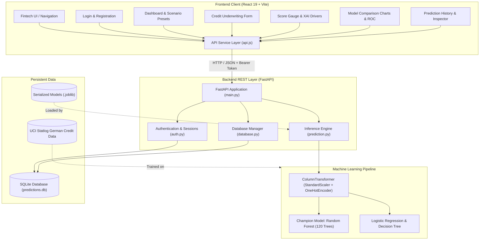

# CrediScore AI: AI-Based Credit Scoring & Creditworthiness Prediction System

An end-to-end machine learning credit risk underwriting and decisioning platform. CrediScore AI processes historical borrower financial data to predict creditworthiness, compute a standardized 300–850 credit score, classify applicants into risk tiers (Low, Moderate, High), and generate transparent, human-readable decision drivers for regulatory explainability.

- **Live Application:** [https://akash2025it-gif.github.io/codeAlpha_credit_scoring_model/](https://akash2025it-gif.github.io/codeAlpha_credit_scoring_model/)
- **Repository:** [https://github.com/akash2025it-gif/codeAlpha_credit_scoring_model](https://github.com/akash2025it-gif/codeAlpha_credit_scoring_model)
- **Primary Hosting:** Vercel / GitHub Pages

---

## 1. Project Overview

Credit underwriting is one of the most critical risk-management functions in retail banking. Traditional credit evaluations have long relied on rigid cutoff rules and manual heuristics. These legacy approaches struggle to capture non-linear interactions across borrower debt obligations, liquidity reserves, and historical payment discipline.

Flawed underwriting causes two symmetrical failure modes:
1. **Type I Errors (False Negatives / Underwriting Drag):** Solvent, creditworthy applicants are erroneously rejected, depriving institutions of legitimate interest revenue and alienating qualified borrowers.
2. **Type II Errors (False Positives / Default Exposure):** Distressed or overleveraged applicants are approved, leading to loan delinquency, default write-offs, and severe capital erosion.

CrediScore AI addresses this challenge by deploying a comparative supervised machine learning pipeline trained on verified historical credit profiles, enriched with domain-informed financial ratios, and made transparent through Explainable AI (XAI) factor extraction.

---

## 2. Key Features

- **Genuine Machine Learning Engine:** 100% of creditworthiness evaluations originate from trained scikit-learn models. No hard-coded, dummy, or random prediction heuristics.
- **Multi-Algorithm Comparison:** Benchmarks and compares **Logistic Regression**, **Decision Tree**, and **Random Forest** on out-of-sample holdout test data.
- **Domain Financial Feature Engineering:** Automatically derives Debt-to-Income (DTI), Loan-to-Income (LTI), Monthly Payment Burden, and a Composite Financial Resilience Index.
- **Standardized Credit Score (300–850):** Maps machine-learning probability outputs to an industry-standard credit bureau score range with intuitive risk tiers.
- **Explainable AI (XAI) Drivers:** Extracts positive credit drivers and negative risk alerts for each assessment, meeting regulatory fair-lending transparency standards.
- **Interactive Underwriting Presets:** Instant one-click evaluation of standardized borrower archetypes: Prime (Low Risk), Moderate (Standard), and Strained (High Risk).
- **Secure Authentication & RBAC:** User registration, PBKDF2-HMAC-SHA256 password hashing with unique salts, and token-based session management.
- **Persistent SQLite Audit Trail:** Full historical logging of every credit assessment with multi-parameter filtering, search, individual record inspection, and CSV export.
- **Modern Fintech UI/UX:** Responsive single-page application built with React 19, Tailwind CSS, Recharts analytics, and Lucide icons.

---

## 3. Technology Stack

| Layer | Technology | Purpose |
| :--- | :--- | :--- |
| **Frontend Framework** | React 19 + Vite 8 | Single-page application architecture with fast compilation |
| **Styling & Design** | Tailwind CSS v4 | Dark slate enterprise fintech interface |
| **Data Visualization** | Recharts | Grouped benchmark charts, ROC curves, and score progress gauges |
| **Icons** | Lucide React | Professional UI iconography |
| **Backend Framework** | FastAPI (Python 3.10+) | Asynchronous high-performance REST API with Pydantic validation |
| **ASGI Server** | Uvicorn | Production-ready HTTP/ASGI application server |
| **Machine Learning** | scikit-learn | Supervised classifiers, preprocessing pipelines, holdout metrics |
| **Data Processing** | pandas + numpy | Dataset cleaning, encoding, and financial feature engineering |
| **Model Persistence** | joblib | Serialized model pipelines, preprocessors, and evaluation metrics |
| **Database** | SQLite 3 | Embedded transactional storage for users, sessions, and audit history |
| **Security** | hashlib (PBKDF2-SHA256) | NIST-compliant password hashing with 100,000 iterations and salt |

---

## 4. System Architecture



### Directory Structure

```text
codeAlpha_credit_scoring_model/
├── .github/
│   └── workflows/
│       └── deploy-pages.yml             # GitHub Actions workflow for Pages deployment
├── api/
│   └── index.py                         # Vercel serverless entry point
├── backend/
│   ├── data/
│   │   ├── german.data                  # Raw UCI Statlog German Credit data
│   │   ├── german_credit.csv            # Cleaned, mapped 1,000-instance dataset
│   │   └── predictions.db               # SQLite database (users, sessions, history)
│   ├── models/
│   │   ├── best_model.joblib            # Serialized Random Forest winning pipeline
│   │   ├── all_models.joblib            # Comparison model dictionary
│   │   ├── preprocessor.joblib          # ColumnTransformer pipeline
│   │   └── model_metrics.json           # Out-of-sample metrics, ROC points, importances
│   ├── src/
│   │   ├── auth.py                      # Authentication routes, password hashing, sessions
│   │   ├── config.py                    # System paths, constants, and risk thresholds
│   │   ├── database.py                  # SQLite schema definitions and queries
│   │   ├── main.py                      # FastAPI application and route endpoints
│   │   ├── prediction.py                # Inference engine, Pydantic schemas, XAI drivers
│   │   ├── preprocessing.py             # Feature engineering, cleaning, transformers
│   │   ├── test_api.py                  # Local model verification script
│   │   ├── test_endpoints.py            # Integration test suite (10/10 endpoints)
│   │   └── train.py                     # Training script for all 3 algorithms
│   └── requirements.txt                 # Backend Python dependencies
├── frontend/
│   ├── src/
│   │   ├── components/
│   │   │   ├── About.jsx                # Technical methodology documentation
│   │   │   ├── CreditPrediction.jsx     # Underwriting application form & loading stage
│   │   │   ├── Dashboard.jsx            # KPIs, interactive scenario presets, recent logs
│   │   │   ├── Footer.jsx               # System status footer
│   │   │   ├── Login.jsx                # Sign-in form with demo quick-fill & eye toggle
│   │   │   ├── ModelPerformance.jsx     # Grouped metric charts, ROC curves, confusion matrix
│   │   │   ├── Navbar.jsx               # Navigation bar with user avatar & status badge
│   │   │   ├── PredictionDetailView.jsx # Dedicated single-record audit inspector
│   │   │   ├── PredictionHistory.jsx    # Filterable audit trail table with CSV export
│   │   │   ├── PredictionResultView.jsx # Credit score gauge, risk badge, print report
│   │   │   ├── Profile.jsx              # User profile & password management
│   │   │   ├── Register.jsx             # Account registration with password strength meter
│   │   │   └── Toast.jsx                # Notification system
│   │   ├── pages/                       # High-level route views
│   │   ├── services/
│   │   │   └── api.js                   # Centralized API service with auth token handling
│   │   ├── App.jsx                      # State machine & view orchestrator
│   │   ├── index.css                    # Tailwind CSS v4 directives
│   │   └── main.jsx                     # Application bootstrap
│   ├── package.json                     # Frontend dependencies & build scripts
│   └── vite.config.js                   # Vite configuration
├── package.json                         # Root package.json for monorepo build compatibility
├── requirements.txt                     # Root requirements for Vercel Python runtime
├── vercel.json                          # Vercel deployment configuration & API rewrites
└── README.md                            # Comprehensive project documentation
```

---

## 5. Machine Learning Methodology

### 5.1 Dataset Specification
The model pipeline is trained on the **Statlog German Credit dataset**, originally curated by Prof. Dr. Hans Hofmann at the University of Hamburg and distributed by the **UCI Machine Learning Repository**.
- **Sample Count:** 1,000 borrower profiles (zero synthetic or fabricated records).
- **Target Variable:** Binary credit risk (`1` = Creditworthy / Good, `0` = Non-Creditworthy / Bad).
- **Class Distribution:** 700 Good (70.0%) vs. 300 Bad (30.0%).
- **Data Quality:** 0 missing values, 0 duplicate rows.

### 5.2 Preprocessing & Feature Encoding
Feature transformation is handled by a scikit-learn `ColumnTransformer` fitted exclusively on training data:
- **Numerical Features (13 variables):** Scaled via `StandardScaler` to ensure zero mean and unit variance.
- **Categorical Features (13 variables):** Encoded via `OneHotEncoder(handle_unknown='ignore', sparse_output=False)` to prevent runtime crashes when encountering novel category combinations.

### 5.3 Train / Test Split & Leakage Safeguards
- **Split Ratio:** Stratified 80% Training (800 profiles) / 20% Holdout Testing (200 profiles).
- **Stratification:** Preserves the 70/30 class proportion across both training and test partitions.
- **Random Seed:** Fixed seed (`random_state=42`) guarantees full scientific reproducibility.
- **Data Leakage Safeguard:** Preprocessor fitting is strictly isolated to `X_train`. Transformation parameters are applied to `X_test` without refitting.

### 5.4 Supervised Learning Algorithms
1. **Logistic Regression:** Regularized linear model utilizing the log-odds sigmoid function with L2 regularization (`C=0.5`), balanced class weights, and standard convergence bounds.
2. **Decision Tree Classifier:** Non-linear partitioning model regularized via `max_depth=5`, `min_samples_split=10`, and `min_samples_leaf=5` to prevent branch overfitting.
3. **Random Forest Classifier (Champion):** Bagging ensemble of 120 decorrelated decision trees (`n_estimators=120`, `max_depth=8`, `min_samples_leaf=3`, `random_state=42`).

---

## 6. Model Comparison & Verified Results

The three algorithms were evaluated on the **identical 200-sample out-of-sample holdout test partition** (60 default profiles, 140 creditworthy profiles):

| Metric | Logistic Regression | Decision Tree | Random Forest (Champion) |
| :--- | :---: | :---: | :---: |
| **Accuracy** | 68.50% | 61.00% | **71.00%** |
| **Precision (Approval)** | 84.07% | 77.19% | **84.17%** |
| **Recall (Sensitivity)** | 67.86% | 62.86% | **72.14%** |
| **F1-Score** | 75.10% | 69.29% | **77.69%** |
| **ROC-AUC** | 76.13% | 66.92% | **78.58%** |
| **True Negatives (TN)** | 42 | 34 | **41** |
| **False Positives (FP)** | 18 | 26 | **19** |
| **False Negatives (FN)** | 45 | 52 | **39** |
| **True Positives (TP)** | 95 | 88 | **101** |

### Champion Model Selection Rationale
In retail credit risk underwriting, **False Positives** (approving a borrower who ultimately defaults) carry catastrophic loss compared to False Negatives (declining a viable applicant). **Random Forest** achieved:
- The highest **ROC-AUC (78.58%)**, demonstrating superior ranking capability across varying decision thresholds.
- The highest **Approval Precision (84.17%)**, ensuring over 84% of approved applications are truly solvent.
- The highest overall **F1-Score (77.69%)** and **Recall (72.14%)**, approving 101 out of 140 solvent applicants while keeping default approvals constrained to 19.

---

## 7. Domain Financial Feature Engineering

Before model ingestion, raw application variables are transformed into four domain-informed financial ratios:

### 1. Monthly Installment Burden
$$\text{Monthly Installment} = \frac{\text{Credit Amount}}{\text{Duration in Months}}$$
*Purpose:* Quantifies the periodic liquid payment required to amortize the debt obligation.

### 2. Estimated Annual Income
$$\text{Monthly Income} = \frac{\text{Monthly Installment}}{\text{Installment Bracket} \times 0.08}, \quad \text{Annual Income} = \text{Monthly Income} \times 12$$
*Purpose:* Reconstructs an annualized borrower income baseline from standardized bracket data.

### 3. Debt-to-Income Ratio (DTI %)
$$\text{DTI} = \left( \frac{\text{Monthly Installment}}{\text{Estimated Monthly Income}} \right) \times 100$$
*Underwriting Threshold:* DTI $\le 28\%$ indicates safe servicing capacity; DTI $> 35\%$ signals elevated debt burden.

### 4. Loan-to-Income Ratio (LTI)
$$\text{LTI} = \frac{\text{Credit Amount}}{\text{Estimated Annual Income}}$$
*Underwriting Threshold:* Compares requested credit principal against annual earning power.

### 5. Composite Financial Resilience Index (0 to 10 Scale)
Synthesizes checking balance status, savings liquidity tiers, and existing credit counts into an integrated buffer metric.

---

## 8. Application Modules & User Journey

The application delivers an 18-step connected fintech experience across 10 functional modules:

1. **Authentication (Login & Registration):**
   - Secure sign-in with email or username and password visibility toggle.
   - Built-in **Demo Reviewer Quick-Fill** (`demo_analyst` / `Password@123`) for evaluation.
   - Self-service registration with a real-time **Password Strength Meter** (length, casing, numerals, special characters).
2. **Executive Dashboard:**
   - Real-time pipeline KPIs (Active Model, ROC-AUC, Approval Precision, Benchmark Dataset Size).
   - Three interactive scenario presets: **Alice (Low Risk)**, **Charlie (Moderate Risk)**, and **Bob (High Risk)**.
   - Feature engineering architecture summary and recent decision previews.
3. **Credit Assessment Form:**
   - Structured 20-variable input form across loan terms, financial reserves, employment, and demographics.
   - Dynamic real-time financial ratio strip (Monthly Payment, Annual Income, DTI %, LTI).
4. **Underwriting Loading Experience:**
   - High-fidelity underwriting stage indicator displaying real-time pipeline execution steps (parameter validation, ratio synthesis, model inference, XAI driver extraction).
5. **Dedicated Prediction Results View:**
   - Standardized 300–850 Credit Score Gauge with color-coded classification tiers.
   - Risk Category Badge (Low, Moderate, High Risk) with model confidence percentage.
   - "Print / Export Underwriting Report" utility and "View in Audit History" navigation.
6. **Explainable AI (XAI) Driver Engine:**
   - Individualized breakdown of positive factors (e.g., strong checking liquidity, clean repayment history) and negative factors (e.g., high debt burden, limited collateral).
7. **Model Performance & Analytics:**
   - Side-by-side metric comparison table for all 3 algorithms.
   - Recharts comparative grouped bar chart.
   - Interactive 2×2 Confusion Matrix selector.
   - Receiver Operating Characteristic (ROC) curve with AUC display.
   - Top 15 Feature Importances ranking from the Random Forest ensemble.
8. **Prediction History Audit Trail:**
   - Immutable SQLite transaction log of past evaluations.
   - Search by applicant name and filter by risk category or decision label.
   - One-click CSV export utility.
   - In-app custom confirmation modal for audit log clearance.
9. **Individual Prediction Inspector:**
   - Dedicated audit view displaying all computed financial ratios, decision explanations, and the complete raw 20-variable JSON model input payload.
10. **Profile & Account Settings:**
    - Risk officer profile information (Name, Role, Department, Corporate Email).
    - Profile update and secure password change forms.
    - Session termination and logout.

---

## 9. API Documentation

The backend exposes a RESTful API built with FastAPI:

### Authentication Endpoints

| Method | Endpoint | Description | Auth Required |
| :--- | :--- | :--- | :---: |
| `POST` | `/api/auth/register` | Creates a new risk officer account | No |
| `POST` | `/api/auth/login` | Authenticates user; returns 7-day bearer session token | No |
| `GET` | `/api/auth/me` | Returns current authenticated user profile | Bearer Token |
| `PUT` | `/api/auth/profile` | Updates user full name, email, or department | Bearer Token |
| `POST` | `/api/auth/change-password` | Updates password after verifying current credentials | Bearer Token |
| `POST` | `/api/auth/logout` | Revokes the current session token | Bearer Token |

### Credit Scoring Endpoints

| Method | Endpoint | Description | Auth Required |
| :--- | :--- | :--- | :---: |
| `GET` | `/api/health` | Health check, active champion model, and available algorithms | No |
| `POST` | `/api/predict` | Runs credit assessment; returns decision, score, probability, drivers | Optional |
| `GET` | `/api/model-metrics` | Returns holdout benchmark metrics, ROC curve points, importances | No |
| `GET` | `/api/prediction-history` | Returns paginated list of recorded credit assessments | Optional |
| `GET` | `/api/prediction-history/{id}` | Returns single assessment record with raw JSON inputs | Optional |
| `DELETE` | `/api/prediction-history` | Clears all demonstration records from SQLite | Bearer Token |

### Sample Prediction Request & Response

**POST `/api/predict`**
```json
{
  "applicant_name": "Alexander Vance",
  "duration_in_month": 18,
  "credit_amount": 3200.0,
  "installment_rate_percent_income": 2,
  "present_residence_since": 3,
  "age_in_years": 38,
  "number_existing_credits": 1,
  "number_people_liable_maintenance": 1,
  "status_existing_checking_account": "high_balance_over_200",
  "credit_history": "existing_credits_paid_duly",
  "purpose": "car_new",
  "savings_account_bonds": "over_1000",
  "present_employment_since": "over_7_years",
  "personal_status_and_sex": "male_single",
  "other_debtors_guarantors": "none",
  "property": "real_estate",
  "other_installment_plans": "none",
  "housing": "own",
  "job": "skilled_employee_official",
  "telephone": "registered",
  "foreign_worker": "no",
  "model_name": "Random Forest"
}
```

**Response (HTTP 200 OK):**
```json
{
  "prediction": "Creditworthy",
  "prediction_code": 1,
  "probability": 0.8121,
  "risk_level": "Low",
  "risk_score": 747,
  "model_used": "Random Forest",
  "explanation": "Applicant evaluated as 'Creditworthy' with 81.2% confidence under the Random Forest model (Risk Level: Low, Score: 747). Assessment is driven primarily by liquid checking status, historical discipline, and a DTI of 16.0%.",
  "key_drivers": [
    {
      "feature": "Checking Balance",
      "impact": "positive",
      "description": "Sustained positive liquid checking balance."
    },
    {
      "feature": "Repayment History",
      "impact": "positive",
      "description": "Consistent track record of fulfilling credit obligations on time."
    },
    {
      "feature": "Debt-to-Income (DTI)",
      "impact": "positive",
      "description": "Healthy DTI ratio of 16.0%, indicating strong debt servicing capacity."
    }
  ],
  "financial_ratios": {
    "monthly_installment": 177.78,
    "estimated_annual_income": 13333.5,
    "debt_to_income_ratio": 16.0,
    "loan_to_income_ratio": 0.24,
    "financial_resilience_score": 9.0
  },
  "disclaimer": "This application is an educational machine-learning demonstration and underwriting simulation platform.",
  "record_id": 15
}
```

---

## 10. Installation & Local Setup

### Prerequisites
- **Python:** 3.10, 3.11, 3.12, 3.14, or 3.15
- **Node.js:** 18.x, 20.x, or 22.x (with npm)
- **Git**

### Step 1: Clone the Repository
```bash
git clone https://github.com/akash2025it-gif/codeAlpha_credit_scoring_model.git
cd codeAlpha_credit_scoring_model
```

### Step 2: Backend Setup
```bash
# Create and activate a Python virtual environment (optional but recommended)
python -m venv venv
# On Windows:
.\venv\Scripts\activate
# On macOS / Linux:
source venv/bin/activate

# Install backend dependencies
pip install -r backend/requirements.txt
```

### Step 3: (Optional) Re-Train ML Models
```bash
python backend/src/train.py
```
*This downloads the UCI German Credit dataset (if not present), executes preprocessing, trains all 3 models, prints evaluation metrics, and serializes the `.joblib` artifacts into `backend/models/`.*

### Step 4: Run the Backend API Server
```bash
cd backend/src
python -m uvicorn main:app --host 127.0.0.1 --port 8000 --reload
```
- API Base URL: `http://127.0.0.1:8000`
- Swagger Interactive Docs: `http://127.0.0.1:8000/docs`

### Step 5: Frontend Setup & Launch (Separate Terminal)
```bash
cd frontend
npm install
npm run dev
```
- Web Application URL: `http://localhost:5173`

---

## 11. Environment Configuration

### Frontend (`frontend/.env` or `.env.local`)
```env
# URL of the backend API.
# Leave blank or set to '/api' for production monorepo deployment on Vercel.
# For local development with separate servers, set:
VITE_API_BASE_URL=http://127.0.0.1:8000
```

### Backend (`backend/src/config.py`)
All core paths and underwriting constants are centralized:
- `RISK_THRESHOLD_LOW = 0.70` (Approval probability $\ge 70\%$ classifies as Low Risk)
- `RISK_THRESHOLD_MEDIUM = 0.50` (Approval probability $50\% - 70\%$ classifies as Moderate Risk)
- `SCORE_MIN = 300`, `SCORE_MAX = 850` (Credit bureau scale mapping)

---

## 12. Vercel Deployment Instructions

The repository is configured for full-stack monorepo deployment on Vercel:

1. **Root Configuration (`vercel.json`):**
   ```json
   {
     "buildCommand": "cd frontend && npm install && npm run build",
     "outputDirectory": "frontend/dist",
     "rewrites": [
       { "source": "/api/:path*", "destination": "/api/index.py" }
     ],
     "functions": {
       "api/index.py": {
         "includeFiles": "backend/**"
       }
     }
   }
   ```
2. **Serverless Entry Point (`api/index.py`):**
   Mounts the FastAPI application at `/api` and root, with an automatic in-memory fallback trainer that guarantees continuous availability if Python environment versions differ between development and serverless runtimes.
3. **Root `package.json` & `api/requirements.txt`:**
   Provides universal build scripts for Vercel's build pipeline and dedicated serverless runtime dependencies.
4. **College Demonstration & Private Deployment Protection:**
   To restrict access during academic evaluations, enable Vercel Deployment Protection in **Project Settings -> Security -> Deployment Protection -> Password Protection**. Visitors will be prompted for a password before viewing the deployed application. Authenticated underwriting actions inside the app are secured via PBKDF2-HMAC-SHA256 credentials (`demo_analyst` / `Password@123`).

### Deploying via Vercel CLI
```bash
npm install -g vercel
vercel
```

---

## 13. Application Screenshots & Visual Guide

The application interface follows a modern, dark-slate enterprise aesthetic:

1. **Authentication & Reviewer Access (`/login`):**
   - Clean, centered card with project identity badge.
   - Username/email input, password input with visibility toggle, and instant **Demo Reviewer Quick-Fill** button.
2. **Registration & Password Strength (`/register`):**
   - Professional underwriting account creation form.
   - Real-time password strength meter evaluating length, casing, numerals, and special characters.
3. **Underwriting Dashboard (`/dashboard`):**
   - 4 top-level metric KPI cards showing active pipeline, holdout precision, and dataset size.
   - Interactive borrower scenario cards for instant evaluation (Alice, Charlie, Bob).
   - Domain feature engineering overview and recent decision logs.
4. **Credit Assessment Form (`/predict`):**
   - 4 organized parameter sections with dynamic real-time financial ratio calculation strip.
   - Interactive underwriting loader showing live multi-step pipeline execution.
5. **Prediction Results View (`/result`):**
   - Standardized 300–850 Credit Score Gauge with color-coded risk tier badges.
   - Explainable AI cards displaying individualized positive and negative decision drivers.
   - "Print / Export Underwriting Report" action.
6. **Model Analytics & Benchmarks (`/models`):**
   - Comprehensive metric comparison table.
   - Recharts comparative grouped bar chart.
   - 2×2 interactive Confusion Matrix selector.
   - Receiver Operating Characteristic (ROC) curve.
   - Top 15 feature importance horizontal rankings.
7. **Prediction Audit Trail (`/history`):**
   - Searchable, filterable audit table with CSV download and custom deletion confirmation modal.
8. **Individual Record Inspector (`/detail`):**
   - Full-page inspection view rendering all calculated ratios and the raw 20-variable JSON payload.

---

## 14. Project Limitations & Academic Scope

1. **Sample Volume:** The Statlog German Credit dataset contains 1,000 historical records. While statistically sufficient for educational and prototype evaluation, commercial credit bureau models train on tens of millions of active accounts.
2. **Macroeconomic Variables:** The dataset reflects a static observation window and does not incorporate dynamic macroeconomic shocks (such as interest rate hikes, inflation spikes, or localized unemployment surges).
3. **Monetary Unit Context:** Historical credit amounts are denominated in Deutsche Mark (DM) and serve as a proxy for credit currency.
4. **Educational Scope Notice:** CrediScore AI is an academic machine learning demonstration and underwriting simulation platform. It is not an authorized credit rating agency and should not be used as the sole basis for actual commercial lending decisions.

---

## 15. License

Developed for educational demonstration, portfolio presentation, and internship evaluation.
Dataset sourced from the **UCI Machine Learning Repository** (Prof. Dr. Hans Hofmann, University of Hamburg).
